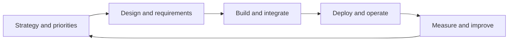
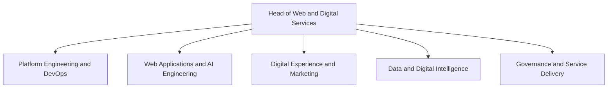
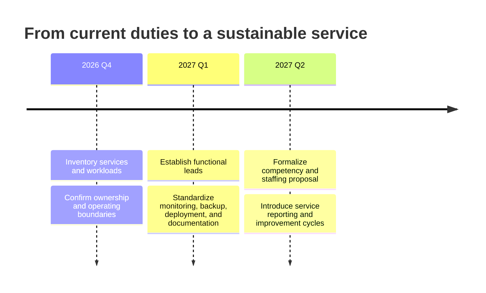

---
layout: center
class: text-center
---

# UTM Web & Digital Services Unit

## A multidisciplinary operating model for the university web ecosystem

Proposal for discussion · November 2026

::: notes
This is a working proposal. The objective is to define the functions required to operate university web services end to end, not to prescribe an immediate headcount.
:::

---

# The decision we need to make

Should university web management continue to be treated as a narrow webmaster or full-stack developer function?

Or should it be recognized as a coordinated digital service with distinct capabilities for:

- Platform operations
- Software and AI engineering
- Digital experience
- Data and digital intelligence
- Governance and service delivery

::: notes
The proposal separates functional responsibilities from individual posts. One officer may cover several functions initially, but the functions still need to be visible and governed.
:::

---

layout: two-cols
---

# Why the current model is under pressure

- More websites, applications, integrations, and data sources
- Higher expectations for availability, speed, security, and accessibility
- Growing use of analytics, automation, AI, and digital campaigns
- Operational knowledge concentrated in a small number of individuals
- Technical decisions often made after requirements and procurement are already fixed

::right::

The web unit is already operating across multiple professional disciplines.

---

# The actual scope is broader than website development

| Capability | Examples of work |
| --- | --- |
| Platform engineering | Docker, NGINX, PHP-FPM, Redis, backups, monitoring |
| Web and application engineering | WordPress, plugins, APIs, SSO, dashboards, integrations |
| Security and reliability | Hardening, patching, incident response, disaster recovery |
| Digital experience | UX, accessibility, branding implementation, SEO, content journeys |
| Data and intelligence | Web analytics, marketing analytics, search visibility, reporting |
| Automation and AI | Chatbots, agents, workflow automation, content intelligence |
| Governance | PTJ coordination, standards, audits, documentation, training |

::: notes
This inventory can later be converted into a workload and competency assessment. It is evidence that the current scope already crosses conventional job boundaries.
:::

---

# Proposed operating model

The unit should own the complete service lifecycle:

**Strategy → Design → Development → Deployment → Security → Operations → Analytics → Optimization**

---

# Five functional teams

These are functional domains. They do not imply that five separate departments must be created immediately.

---

layout: two-cols
---

# What each team owns

### Platform Engineering and DevOps
Hosting, deployment, observability, performance, backups, recovery, and runtime reliability.

### Web Applications and AI Engineering
Websites, CMS extensions, applications, APIs, SSO, chatbots, agents, testing, and maintainability.

### Digital Experience and Marketing
UX, accessibility, visual implementation, SEO, content presentation, campaigns, and conversion journeys.

::right::

### Data and Digital Intelligence
Web analytics, marketing analytics, search visibility, dashboards, attribution, benchmarking, and insight.

### Governance and Service Delivery
PTJ coordination, standards, audits, requirements, documentation, training, and stakeholder acceptance.

::: notes
The most important distinction is between a function and a post. Functions should be protected even when staffing is lean.
:::

---

# Web analytics belongs with digital intelligence

| Discipline | Core question |
| --- | --- |
| Web analytics | Is the website performing effectively? |
| Marketing analytics | Are campaigns reaching and influencing the intended audience? |
| Digital intelligence | What should UTM decide or improve based on the evidence? |

The unit should own instrumentation, data quality, technical analysis, dashboards, and reporting infrastructure.

Corporate Communication and PTJs should continue to own communication objectives, editorial decisions, and campaign priorities.

---

layout: image
image: /images/web-unit-placeholder.svg
---

# A service, not a collection of websites

::: notes
Use this as a visual pause before discussing the staffing model. Replace the placeholder visual with an approved UTM diagram or photograph later.
:::

---

# Practical staffing model

| Model | Indicative capability | Use |
| --- | --- | --- |
| Lean | 6 core staff plus shared specialists | Stabilize essential operations and separate critical responsibilities |
| Recommended | 10 core staff plus shared specialists | Balance operations, engineering, analytics, governance, and experience |
| Mature | 16 core staff across five domains | Support university-wide scale, resilience, and continuous improvement |

The recommended model is a planning target, not an immediate establishment request.

First measure:

- Number and criticality of services
- Technical complexity and operational load
- Coverage required outside office hours
- Security and compliance exposure
- Dependency on individual officers

---

# Why this matters for Skim F

Modern technical services require recognized specializations beyond generic support or application development.

| Emerging specialization | Typical responsibility |
| --- | --- |
| Platform engineering | Cloud, containers, deployment, observability, resilience |
| Software engineering | CMS, applications, APIs, testing, architecture |
| Security engineering | Hardening, vulnerability management, incident response |
| Data engineering and BI | Instrumentation, pipelines, dashboards, data quality |
| AI engineering | Models, agents, integrations, evaluation, governance |
| Technical business analysis | Requirements, service design, feasibility, benefits |

The establishment should recognize the work actually required to operate a modern digital university.

---

# Clear boundaries prevent scope expansion

| Area | Primary responsibility |
| --- | --- |
| University websites and web applications | Web and Digital Services Unit |
| Web hosting platform and deployment | Web Unit, coordinated with central ICT |
| University-wide network and data centre | UTMDX / central ICT |
| University-wide security authority | Central ICT security function |
| Web security implementation | Web Unit |
| Official branding and editorial approval | Corporate Communication / PTJ |
| PTJ website content ownership | Respective PTJ |

---

# Proposed implementation path

The first deliverable should be an evidence-based role-to-workload map.

---

layout: center
class: text-center
---

# Proposed decision

Recognize UTM web management as an end-to-end digital service function with:

- Five protected capability domains
- Clear boundaries with central ICT and Corporate Communication
- A workload-based staffing assessment
- A structured technical career and competency pathway
- Shared accountability for reliability, security, experience, and impact

Next: validate the model with current service and workload evidence

::: notes
The next working session should refine the organizational chart and map each current responsibility to a proposed function, estimated effort, risk, and required competency.
:::
