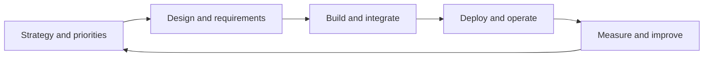
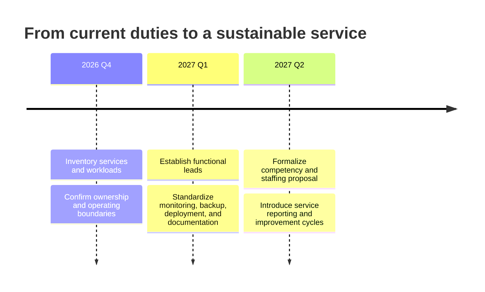

---
layout: center
class: text-center
---

# UTM Web & Digital Services Unit

## A multidisciplinary operating model for the university web ecosystem

UTM WEB &amp; DIGITAL COMMUNICATION

Working proposal for management discussion · November 2026

::: notes
This is a working proposal. The objective is to define the functions required to operate university web services end to end, not to prescribe an immediate headcount.
:::

---

# The management decision

UTM’s web function now supports public-facing services, internal workflows, data collection, campaigns, and digital transformation. It should be structured as a digital service capability, not treated as a single webmaster role.

The proposed model protects distinct capabilities for:

- Platform operations
- Software and AI engineering
- Digital experience
- Data and digital intelligence
- Governance and service delivery

::: notes
The proposal separates functional responsibilities from individual posts. One officer may cover several functions initially, but the functions still need to be visible and governed.
:::

---

layout: two-cols
---

# Why the operating model must evolve

- More websites, applications, integrations, and data sources to operate
- Higher expectations for availability, speed, security, accessibility, and measurable impact
- Growing use of analytics, automation, AI, and digital campaigns
- Operational knowledge concentrated in too few individuals
- Technical consequences considered too late in requirements and procurement

::right::

The web unit is already operating across multiple professional disciplines.

---

# The actual scope is broader than website development

| Capability | Examples of work |
| --- | --- |
| Platform engineering | Docker, NGINX, PHP-FPM, Redis, backups, monitoring |
| Web and application engineering | WordPress, plugins, APIs, SSO, dashboards, integrations |
| Security and reliability | Hardening, patching, incident response, disaster recovery |
| Digital experience | UX, accessibility, branding implementation, SEO, content journeys |
| Data and intelligence | Web analytics, marketing analytics, search visibility, reporting |
| Automation and AI | Chatbots, agents, workflow automation, content intelligence |
| Governance | PTJ coordination, standards, audits, documentation, training |

::: notes
This inventory can later be converted into a workload and competency assessment. It is evidence that the current scope already crosses conventional job boundaries.
:::

---

# Proposed operating model

The unit should own the complete service lifecycle:

**Strategy → Design → Development → Deployment → Security → Operations → Analytics → Optimization**

---
class: org-structure
---

# Proposed organization structure

Head of Web &amp; Digital Services

  

    <strong>Platform Engineering and DevOps</strong>
    DevOps / SRE
    Infrastructure
    Security &amp; reliability
  

  

    <strong>Web Applications and AI Engineering</strong>
    Website / CMS
    Web applications
    Integrations · AI
  

  

    <strong>Digital Experience and Marketing</strong>
    UX / UI
    Accessibility
    SEO · campaigns
  

  

    <strong>Data &amp; Digital Intelligence</strong>
    Web analytics
    Marketing analytics
    BI · data engineering
  

  

    <strong>Governance &amp; Service Delivery</strong>
    Business analysis
    PTJ coordination
    Standards · training
  

Functional domains define the capabilities that must be covered; they do not require five separate departments or one permanent post for every role.

---

layout: two-cols
---

# Functional roles inside the unit

### Platform Engineering and DevOps
- DevOps / SRE
- Infrastructure and runtime reliability
- Security implementation and incident readiness

### Web Applications and AI Engineering
- Website and CMS engineering
- Web applications and integrations
- AI, chatbot, and workflow automation

### Digital Experience and Marketing
- UX/UI and accessibility
- SEO and digital marketing
- Content and conversion experience

::right::

### Data and Digital Intelligence
- Web and marketing analytics
- BI, data engineering, and dashboards
- Search visibility and impact measurement

### Governance and Service Delivery
- Business analysis and PMO
- PTJ coordination and service standards
- Documentation, training, and acceptance

::: notes
Security is a cross-cutting responsibility. The Web Unit implements web and application controls while the central ICT security function retains university-wide authority.
:::

---

# Web analytics belongs with digital intelligence

| Discipline | Core question |
| --- | --- |
| Web analytics | Is the website performing effectively? |
| Marketing analytics | Are campaigns reaching and influencing the intended audience? |
| Digital intelligence | What should UTM decide or improve based on the evidence? |

The unit should own instrumentation, data quality, technical analysis, dashboards, and reporting infrastructure.

Corporate Communication and PTJs should continue to own communication objectives, editorial decisions, and campaign priorities.

---

layout: image
image: /images/web-unit-placeholder.svg
---

# A service, not a collection of websites

::: notes
Use this as a visual pause before discussing the staffing model. Replace the placeholder visual with an approved UTM diagram or photograph later.
:::

---

# Practical staffing model

  

    <h3>Lean</h3>
    
6

    
Core staff plus shared specialists. Protect essential operations and reduce single-person dependency.

  

  

    <h3>Recommended</h3>
    
10

    
Separate platform, engineering, experience, intelligence, and governance capabilities.

  

  

    <h3>Mature</h3>
    
16

    
Five domains with enough depth for university-wide scale, resilience, and continuous improvement.

  

The recommended model is a planning target, not an immediate establishment request.

Before requesting posts, measure:

- Number and criticality of services
- Technical complexity and operational load
- Coverage required outside office hours
- Security and compliance exposure
- Dependency on individual officers

---

layout: two-cols
---

# Recommended initial model: 10 core staff

### Core establishment

1. Head / Web and Digital Service Owner
2. DevOps / SRE and Infrastructure Engineer
3. Security and Reliability Engineer
4. Website and CMS Engineer
5. Web Applications and Integration Engineer

::right::

6. AI and Automation Engineer
7. UX/UI and Accessibility Officer
8. SEO and Digital Marketing Officer
9. Web and Marketing Analytics Officer
10. BI and Data Engineer

Governance, PMO, and PTJ coordination are led by the service owner and supported by designated PTJ coordinators until workload evidence justifies a dedicated business-analysis / service-delivery post. Creative production, advanced security, legal, procurement, and university-wide ICT authority remain shared or centrally coordinated where appropriate.

---

# Why this matters for Skim F

Modern technical services require recognized specializations beyond generic support or application development.

| Emerging specialization | Typical responsibility |
| --- | --- |
| Platform engineering | Cloud, containers, deployment, observability, resilience |
| Software engineering | CMS, applications, APIs, testing, architecture |
| Security engineering | Hardening, vulnerability management, incident response |
| Data engineering and BI | Instrumentation, pipelines, dashboards, data quality |
| AI engineering | Models, agents, integrations, evaluation, governance |
| Technical business analysis | Requirements, service design, feasibility, benefits |

The establishment should recognize the work actually required to operate a modern digital university.

---

# Clear boundaries prevent scope expansion

| Area | Primary responsibility |
| --- | --- |
| University websites and web applications | Web and Digital Services Unit |
| Web hosting platform and deployment | Web Unit, coordinated with central ICT |
| University-wide network and data centre | UTMDX / central ICT |
| University-wide security authority | Central ICT security function |
| Web security implementation | Web Unit |
| Official branding and editorial approval | Corporate Communication / PTJ |
| PTJ website content ownership | Respective PTJ |

---

# Proposed implementation path

The first deliverable should be an evidence-based role-to-workload map.

---

layout: center
class: text-center
---

# Proposed decision

Recognize UTM web management as an end-to-end digital service function with:

- Five protected capability domains
- Clear boundaries with central ICT and Corporate Communication
- A workload-based staffing assessment
- A structured technical career and competency pathway
- Shared accountability for reliability, security, experience, and impact

Next: validate the model with current service and workload evidence

::: notes
The next working session should refine the organizational chart and map each current responsibility to a proposed function, estimated effort, risk, and required competency.
:::
